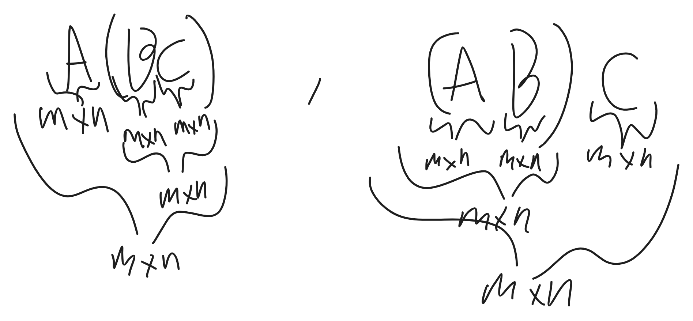

# אלגברה ליניארית 1 - הרצאה 2

> [!NOTE]
> **סיכום קצר**
>
> - **הנושא המרכזי:**
> - **הרעיון המרכזי / מה לקחת מההרצאה:**

---

## 1. מושגים והגדרות מרכזיים

> [!IMPORTANT]
> **הגדרות ותכונות נשמרות**
>
> 

---

## 2. סיכום ההרצאה

### נושא 1

> [!NOTE]
> **הערות והסברים**
>
>


תהי A מטריצה
אזי הצורה הקנונית היא צורה יחידה - נסמן ב-CF(A)

משפט: מטריצות הן שקולות שורה **אם ורק אם** יש להן את אותה צורה קנונית.

# אלגברת מטריצות
$`{}\mathbb{F}^{nxm}={}`${$`{}\text{}{}`$}
N שורות
M עמודות
$`{}M_{n}(\mathbb{F}:=\mathbb{F}^{nxn}){}`$
$`{}\mathbb{F}^{nx1}:=\mathbb{F}^n{}`$


```math
A =\begin{array}{ccc}
a_{11} & a_{12} & \dots a_{1m} \\
a_{21} & a_{22} & \dots a_{2m} \\
a_{n_{1}} & a_{n_{2}} & \dots a_{nm}
\end{array} \in \mathbb{F}^{nxm}
```


### הגדרה: 
תהינה $`{}A,B\in \mathbb{F}^{nxm}{}`$
נגדיר $`{}A+B:= {}`$
$`{}A+B \in \mathbb{F}^{nxm}{}`$
ולכל $`{}1\leq i\leq n, \ 1\leq j\leq m{}`$:
$`{}(A+B)_{ij}:=A_{ij}+B_{ij}{}`$
$`{}:={}`$ היא סימון של הגדרה


הגדרה: תהי $`{}A:=\mathbb{F}^{nxm}{}`$ ויהי $`{}\alpha\in \mathbb{F}{}`$
נגדיר $`{}\alpha A{}`$:
$`{}\alpha A\in \mathbb{F}^{nxm}{}`$
ולכל $`{}1\leq i\leq n, \ 1\leq j\leq m{}`$
$`{}(\alpha A)_{ij}=\alpha A_{ij}{}`$

# תכונות:
תהינה $`{}A,B,C\in \mathbb{F}^{nxm}{}`$
ויהי $`{}\alpha,\beta\in \mathbb{F}{}`$ אזי
1. קומו':$`{}A+B=B+A{}`$


```math
\alpha A=A\alpha
```


2. אסוצ':


```math
\begin{gathered}
(A+B)+C=A+(B+C)\\
\alpha(\beta\cdot A)=\alpha A+\beta A
\end{gathered}
```


3. פילוג:


```math
\begin{gathered}
(\alpha+\beta)A=\alpha A+\beta A\\
\alpha(A+B)=\alpha A+\alpha B
\end{gathered}
```


הוכחה: תהינה $`{}A,B,C\in \mathbb{F}^{nxm}{}`$ ויהיו $`{}\alpha,\beta\in \mathbb{F}{}`$
1.א)
$`{}\underbrace{ \overbrace{ A }^{ nxm }+\overbrace{ B }^{ nxm } }_{ nxm }\ \ ,\ \ \underbrace{ \overbrace{ B }^{ nxm }+\overbrace{ A }^{ nxm } }_{ nxm }{}`$
ולכל $`{}1\leq i\leq n, \ 1\leq j\leq m{}`$:
$`{}(A+B)_{ij}\underbrace{ = }_{\text{ה. חיבור} } A_{ij}+B_{ij}{}`$
$`{}(B+A)_{ij}\overbrace{ = }^{  }B_{ij}+A_{ij}{}`$

1.ב (לבית)

2.א)
הוכחה: תהינה $`{}A,B,C\in \mathbb{F}^{nxm}{}`$ ויהיו $`{}\alpha,\beta\in \mathbb{F}{}`$
$`{}\underbrace{ \underbrace{ (\underbrace{ A }_{ nxm }+\underbrace{ B }_{ nxm }) }_{ nxm }+\underbrace{ C }_{ nxm } }_{ nxm }\ \ \ , \ \ \ \underbrace{ \underbrace{ \underbrace{ A }_{ nxm } }_{ nxm }+\underbrace{ (\underbrace{ B }_{ nxm }+\underbrace{ C }_{ nxm })  }_{ nxm } }_{ nxm }{}`$
ולכל $`{}1\leq i\leq n, \ 1\leq j\leq m{}`$:

$`{}[(A+B)+C]_{ij}\underbrace{ = }_{ \text{ה. חיבור} } (A+B)_{ij}+c_{ij}=A_{ij}+B_{ij}+C_{ij}{}`$
$`{}[A+(B+C)]_{ij}\overbrace{ = }^{  }A_{ij}+B_{ij}+C_{ij}{}`$

3.א)
הוכחה: תהינה $`{}A,B,C\in \mathbb{F}^{nxm}{}`$ ויהיו $`{}\alpha,\beta\in \mathbb{F}{}`$
$`{}\underbrace{ (\underbrace{ \alpha+\beta }_{ \in \mathbb{F} })\underbrace{ A }_{ nxm } }_{ nxm } \ \ , \ \ \underbrace{ \underbrace{ \alpha A }_{ nxm }+\underbrace{ \beta A }_{ nxm } }_{ nxm }{}`$

ולכל $`{}1\leq i\leq n, \ 1\leq j\leq m{}`$:
$`{}[(\alpha+\beta)A]_{ij} \overbrace{ = }^{ \text{כפל בסקלאר} }(\alpha+\beta)A_{ij}{}`$
$`{}[\alpha A+\beta A]_{ij}= (\alpha A)_{ij}+(\beta A)_{ij} = \alpha A_{ij}+\beta A_{ij}{}`$
פילוג בשדה$`{}\uparrow{}`$

### הגדרה: 
מטריצת ה-0 nxm ($`{}0_{\mathbb{nxm}}{}`$) היא מטריצה מסדר nxm כך שכל הכניסות שלה הן הסקלר (איבר בשדה - כרגע מספר) $`{}0_{\mathbb{F}}{}`$
טענה: תהי $`{}A\in \mathbb{F} ^{nxm}{}`$ אזי:
א) $`{}A+\large{0} = A {}`$
ב) $`{}\large0+A = A{}`$

נראה את א:
הוכחה: $`{}A\in \mathbb{F} ^{nxm}{}`$ 


```math
\underbrace{ \underbrace{ A }_{ nxm }+\underbrace{ 0 }_{ nxm } }_{ nxm }
```


ולכל $`{}1\leq i\leq n, \ 1\leq j\leq m{}`$:


```math
(A+0)_{ij}\underbrace{ = }_{ \text{ה. החיבור} }A_{ij}+\underbrace{ 0_{ij} }_{ 0_{\mathbb{F}} }=A \implies A+0=A
```


נראה את ב:
A+0 זה כמו 
0+A
לכן מגיעים לאותו הוכחה של א

הגדרה: תהינה: $`{}A\in \mathbb{F}^{mxn}{}`$, $`{}B\in \mathbb{F}^{nxm}{}`$


```math
A\cdot B\in \mathbb{F}^{mxk}
```


ולכל $`{}1\leq i\leq k, \ 1\leq j\leq m{}`$:


```math
\begin{gathered}
(A\cdot B)_{ij}=\sum_{t=1}^n A_{it}B_{tj}\\
\end{gathered}
```


```math
\overbrace{ \begin{pmatrix}
\begin{array}{ccc}
1 & 2 & 3 \\
1 & 1 & 1
\end{array}
\end{pmatrix} }^{ 2\times 3 }
\overbrace{ \begin{pmatrix}
\begin{array}{cc}
1 & 2  \\
1 & 1  \\
-1 & 4
\end{array}
\end{pmatrix} }^{ 3\times 2 } =
\begin{pmatrix}
\begin{array}{cccccc}
 \overbrace{ -1 }^{ 1,1 } & 20  \\
 \underbrace{ 0  }_{ 2,1 }&\underbrace{ 9  }_{ 2,2 }
\end{array}
\end{pmatrix}
```


כופלים שורה כפול עמודה, כופלים איבר באיבר אחר וממשיכים וסוכמים את הסכומים ושמים אותם במטריצה.
במיקום 2,1 כפלנו את השורה השנייה של המטריצה הראשונה כפול העמודה הראשונה במטריצה 1.

בכפל מטריצות:
$`{}A \cdot B\neq B\cdot A{}`$

# תכונות:
תהינה A,B,C מטריצות (*)
ויהי$`{}\alpha\in \mathbb{F}{}`$ אזי

1. פילוג:


```math
\begin{gathered}
(A+B)C=AC+BC\\
   C(A+B)=CA+CB
\end{gathered}
```


   2. אסוצ'
   

```math
\begin{gathered}
A(BC)=(AB)C\\
   \alpha\cdot(AB)=(\alpha A)B
\end{gathered}
```


 
 הוכחה:
 1. תהינה $`{}A,B\in \mathbb{F}^{mxn}{}`$, $`{}C\in \mathbb{F}^{mxn}{}`$
 תחילה, $`{}\underbrace{ \underbrace{ \underbrace{ A }_{ mxn }\underbrace{ C }_{ mxn } }_{ mxn }+\underbrace{ BC }_{ mxn } }_{ mxn }{}`$ ,  $`{}\underbrace{ (\underbrace{ \underbrace{ A }_{ mxn }+\underbrace{ B }_{ mxn } }_{ mxn })\underbrace{ C }_{ mxn } }_{ mxn }{}`$

ולכל $`{}1\leq j\leq k, \ 1\leq i\leq m{}`$:

$`{}[\overbrace{ (A+B) }^{ mxn }\overbrace{ C }^{ mxn }]_{ij}\overbrace{ = }^{ \text{ה. כפל מטריצות} }\sum_{t=1}^n(A+B)_{it}C_{tj}\overbrace{ = }^{ \text{ה. חיבור} }\sum_{t=1}^n(A_{it}+B_{it})C_{tj}\overbrace{ = }^{ \text{פילוג בשדה} }\boxed{\sum_{t=1}^nA_{it}C_{tj}+B_{it}C_{tj}}{}`$

$`{}[AC+BC]_{it}\underbrace{ = }_{ \text{ה. חיבור מטריצות} }(AC)_{ij}+(BC)_{ij}\underbrace{ = }_{ \text{ה. כפל מטריצות} }\boxed{\sum_{t=1}^nA_{it}C_{tj}+\sum_{t=1}^nB_{it}C_{tj}}`$


2. אסוצ:

2.א)הוכחה:
תהינה $`{}C\in \mathbb{F}^{mxn}{}`$ , $`{}B\in \mathbb{F}^{mxn}{}`$,$`{}A\in\mathbb{F}^{mxn}{}`$




ולכל $`{}1\leq j\leq r, \ 1\leq i\leq m{}`$ מתקיים:
$`{}[A(BC)]_{ij}\underbrace{ = }_{ \text{ה. כפל מטריצות} }\sum_{t=1}^nA_{it}(BC)_{tj}\underbrace{ = }_{ \text{ה. כפל מטריצות} }\sum_{t=1}^nA_{it}\left[( \sum_{p=1}^k B_{tp}C_{pj}\right)]\underbrace{ = }_{ \text{חוק סיגמא פילוג} }\boxed{\sum_{t=1}^n\sum_{p=1}^k[A_{it}(B_{tp}C_{pj})]}{}`$

$`{}[(AB)C]_{ij}\overbrace{ = }^{  }\sum_{p=1}^k(AB)_{ip}C_{pj}\ \ \ \ \ \ \ \ \ \ \ \overbrace{ = }^{  } \sum_{p=1}^k\left( \sum_{t=1}^n A_{it}B_{tp}\right)C_{pj}\underbrace{ = }_{ \text{חוק סיגמא פילוג} }\sum_{p=1}^k\sum_{t=1}^n[(A_{it}B_{tp})C_{pj}]\underbrace{ = }_{ \text{אסוצ' בשדה} }\boxed{\sum_{p=1}^k\sum_{t=1}^n[A_{it}(B_{tp}C_{pj})]}{}`$


קיימת דרך נוספת לכפול מטריצות (נקבל אותה תוצאה כמו מה שלמדנו קודם):
### טענה:
תהינה $`{}a\in \mathbb{F}^{mxn}{}`$, $`{}B\in \mathbb{F}^{mxn}{}`$ אזי.


```math
\begin{gathered}
\forall i\leq i\leq k, \\ \\
\text{א }
\\
C_{i}(AB)=\sum_{t=1}^nC_{t}(A)\cdot B_{ti}\\ \\
\begin{pmatrix}
a_{1} & a_{12} \\
a_{21} & a_{22}
\end{pmatrix}
\begin{pmatrix}
b_{11} & b_{12} \\
b_{21}  & b_{22}
\end{pmatrix}=
\begin{pmatrix}
a_{11}b_{11}+a_{12}b_{21} & a_{11}b_{12}+a_{12}b_{22} \\
a_{21}b_{11}+a_{22}b_{21} & a_{21}b_{12}+a_{22}b_{22}
\end{pmatrix}\\
\\
\begin{pmatrix}
1 & 2 & 3 \\
 4 & 5 & 6  \\
 7 & 8 & 9
\end{pmatrix}
\begin{pmatrix}
1 & 1 & 1 \\
-1 & 0 & 1 \\
3 & 4 & 1
\end{pmatrix}
=
\\
\begin{pmatrix}
1 \\
4 \\
7
\end{pmatrix}\cdot 1+\begin{pmatrix}
2 \\
5 \\
8
\end{pmatrix}\cdot 0+\begin{pmatrix}
3 \\
 6  \\
9
\end{pmatrix}\cdot 4=\begin{pmatrix}
13  \\
 28  \\
43
\end{pmatrix} \text{זאת העמודה השנייה}
\\ \\ ב \\ \\
\forall 1\leq i\leq m \ \ \ \  \ \ \ \ R_{i}(AB) = \sum_{t=1}^n
A_{it}R_{t}(B)
\end{gathered}
```


