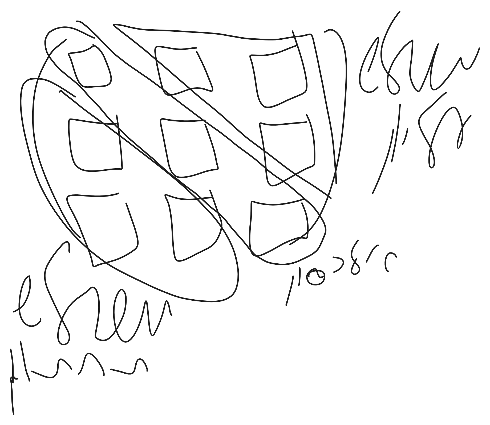
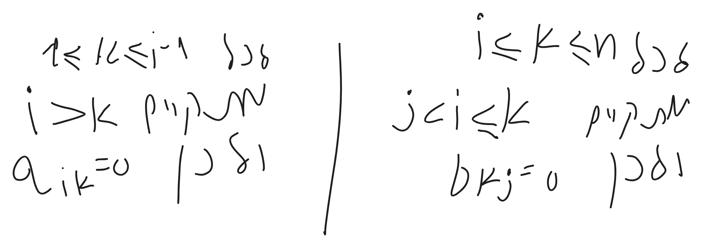

# אלגברה ליניארית 1 - תרגול 2

כאשר 2 מטריצות מעל אותו שדה


```math
a\in \mathbb{F}^{mxn}, B\in \mathbb{F}^{nxk}
```


מוגדרת הכפולה AB
ומתקיים $`{}AB\in \mathbb{F}^{mxk}{}`$


```math
(AB)_{ij}=\sum_{k=1}^na_{ik}\cdot b_{kj}
```


# מטריצות ריבועיות

1. מטריצה נקראת משולשית עליונה אם המשולש התחתון כולו אפסים
2. 

דוג':


```math
\begin{pmatrix}
1 & 0 & 0 \\
0 & 0 & 1 \\
0 & 0 & 1
\end{pmatrix}
```


הגדרה פורמלית:
$`{}A\in \mathbb{F}^{nxm}{}`$
אם לכל $`{} 1\leq i, i\leq n{}`$ מתקיים:
אם i>j אז $`{}a_{ij}=0{}`$


קיים $`{}A\in \mathbb{F}^{nxm}{}`$, היא נקראת משולשית תחתונה אם לכל $`{}1\leq j, j\leq n{}`$: אם i<j אז $`{}a_{ij}=0{}`$ 


מטריצה $`{}A\in \mathbb{F}^{nxm}{}`$נקראת אלכסונית אם היא משולשית עליונה וגם תחתונה
אם לכל $`{}1\leq j, j\leq n{}`$: אם i$`{}\neq{}`$j אז $`{}a_{ij}=0{}`$ 


מטריצת היחידה $`{}I_{n}\in \mathbb{F}^{nxn}{}`$


```math
\begin{pmatrix}
1 & 0 \\
0 & 1
\end{pmatrix}, \begin{pmatrix}
1 & 0 & 0 \\
0 & 1 & 0 \\
0 & 0 & 1
\end{pmatrix}
```


וכו....


$`{}A\in \mathbb{F}^{nxn}{}`$
נקראת סקלרית אם קיים $`{}A=\alpha\cdot I_{n}{}`$
דוג':


```math
\begin{gathered}
I_{n}=1\cdot I_{n}\\
0_{n}=0\cdot I_{n}
\end{gathered}
```


תרגיל:
תהינה $`{}A,B\in \mathbb{F}^{nxn}{}`$. מ.עליונות
הוכיחו כי AB מ. עליונה

הוכחה:
יהיו $`{}1\leq i,j\leq n{}`$ כך ש: i>j
צל: $`{}(AB)_{ij}=0{}`$


```math
\begin{gathered}
(AB)_{ij}=\sum_{k=1}^na_{ik}b_{kj}=\\=\sum_{k=1}^{i-1}a_{ik}b_{kj}+\sum_{k=i+1}^na_{ik}b_{kj}=0
\end{gathered}
```


                   
יוצא ששני הסיגמות 0 ככה שהוכחנו כי  $`{}(AB)_{ij}=0{}`$

### הגדרות:
תהי $`{}A\in \mathbb{F}^{nxn}{}`$ העקבה  (trace) של A היא
$`{}tr(A)=\sum_{i=1}^n=a_{ii}{}`$
דוג':


```math
tr(
\underbrace{ \begin{pmatrix}
1 & 2 & 3 \\
0 & 1 & 2 \\
0 & 1 & 3
\end{pmatrix} }_{ \mathbb{Z}_{3} })=2
```


### תכונות
תהינה $`{}A,B\in \mathbb{F}^{nxn}{}`$ ו- $`{}\alpha\in \mathbb{F}{}`$
1. $`{}tr(\alpha A)=\alpha tr(A){}`$


```math
tr(\alpha A)
```


2. $`{}tr(A+B)=tr(A)+tr(B){}`$ הוכחה שב
3. $`{}tr(AB)=tr(BA){}`$ הוכחה שב


תהי $`{}A\in \mathbb{F}^{mxn}{}`$ המטריצה המשוחלפת (transpose) היא מטריצה 


```math
\begin{gathered}
A^t\in \mathbb{F}^{nxm}\\
\text{כך } \\
(A^t)_{ij}= A_{ji}\\ \\
A=\begin{pmatrix}
1 & 4 \\
2 & 5 \\
 3 & 6
\end{pmatrix}\\
A^t=\begin{pmatrix}
1 & 2 & 3 \\
4 & 5 & 6
\end{pmatrix}
\end{gathered}
```


### תכונות:
1. $`{}(A^t)^t=A{}`$
2. $`{}(\alpha A)^t=\alpha A^t{}`$
3. $`{}(A+B)^t=A^t+B^t{}`$
4. $`{}(AB)^t=B^t+A^t{}`$ הוכחה שב

תרגיל:
תהינה $`{}A\in \mathbb{R}^{mxn}{}`$
א. הוכיחו כי המכפלות $`{}A^tA, AA^t{}`$ מוגדרות
ב. הוכיחו כי אם $`{}tr(AA^t)=0{}`$ אז A=0

פתרון א:


```math
\begin{gathered}
A\in \mathbb{R}^{mxn}, A^t\in \mathbb{R}^{nxm}\\
AA^t\in \mathbb{R}^{mxm}m ,A^tA\in \mathbb{R}^{nxn}
\end{gathered}
```


פתרון ב:


```math
\begin{gathered}
0=tr(AA^t)=\sum_{k=1}^m(AA^t)_{k_{k}}=\sum_{k=1}^m\left( \sum_{p=1}^{n} A_{kp}A^t_{p_{k}} \right)=\sum_{k=1}^m \sum_{p=1}^{n}(A_{kp})^{2}=0\\ (A_{kp})^2\geq 0
\end{gathered}
```


אזי לכל $`{}1\leq k\leq m{}`$ ולכל $`{}1\leq p\leq n{}`$: $`{}(A_{kp})^{2}=0{}`$
אזי לכל $`{}1\leq k\leq m{}`$ ולכל $`{}1\leq p\leq n{}`$: $`{}(A_{kp})=0{}`$
אזי A=0


