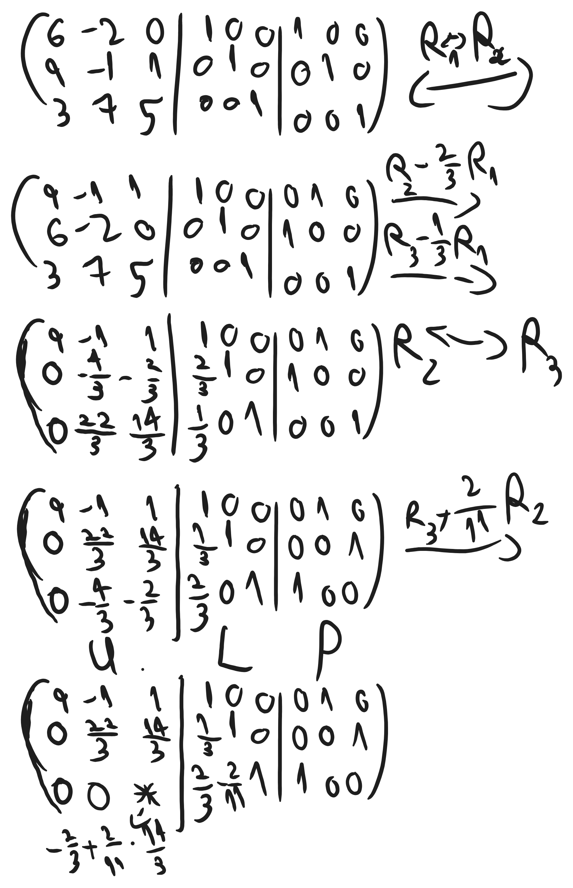
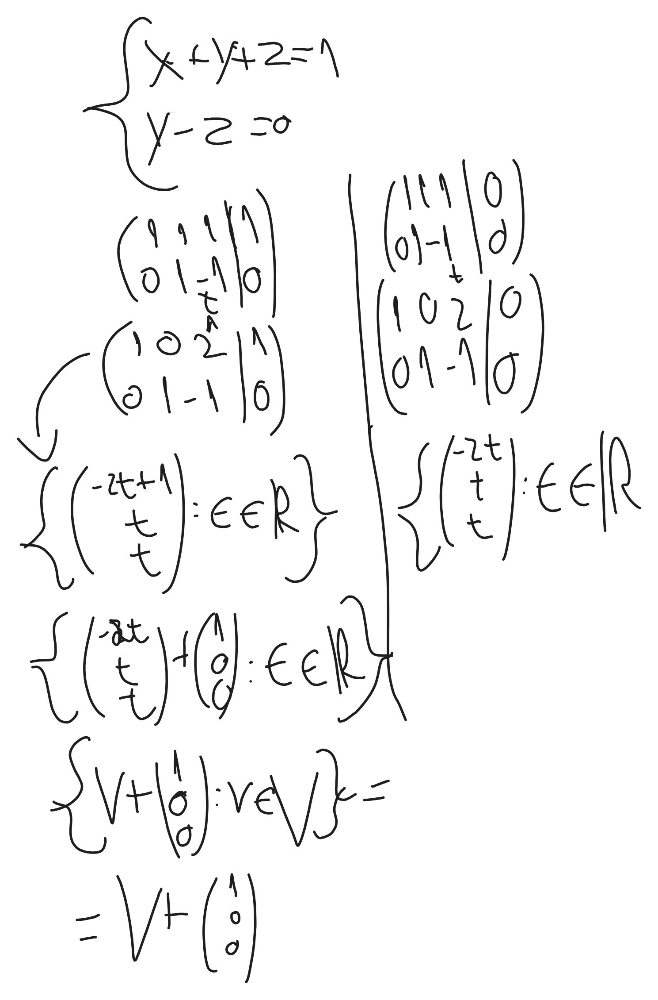

# אלגברה ליניארית 1 - תרגול 4

# פירוק PLU

יש $`{}A\in \mathbb{F}^{nxn}{}`$
רוצים 3 מטריצות P,L,U,
המטריצה P היא מטריצה תמורה (פרמוטציה).
המטריצה L היא מטריצה משולשית תחתונה.
מטריצה U היא מטריצה משולשית עליונה.


```math
PA=LU
```


```math
(A|I|I)\to(U|L|P)
```


### כללי דירוג
1) שפל שורה בסקלר - אסור
2) כפילה מסוג $`{}R_{i}+2R_{j}{}`$:
על U מבצעים רגיל
על P לא מבצעים
על L מבצעים הפוך במקום מה שמתאפס בU

3) החלפת שורות
על P רגיל
על U רגיל
על L רק מתחת לאלכסון




```math
\begin{gathered}
P=\begin{pmatrix}
0 & 1 & 0 \\
0 & 0 & 1 \\
1 & 0 & 0
\end{pmatrix}\\ \\
L=\begin{pmatrix}
1 & 0 & 0 \\
2 & 1 & 0 \\
-1 & 3 & 1
\end{pmatrix}\\ \\
U=\begin{pmatrix}
3 & 1 & -1 \\
0 & 2 & \frac{1}{2} \\
0 & 0 & 1
\end{pmatrix}\\
Ax=\begin{pmatrix}
1 \\
2 \\
3
\end{pmatrix}\\
PAx=P\begin{pmatrix}
1 \\
2 \\
3
\end{pmatrix}=\begin{pmatrix}
2 \\
3 \\
1
\end{pmatrix}\\
LUx=\begin{pmatrix}
2 \\
3 \\
1
\end{pmatrix}\\
\bar x=Ux\\
L\bar x=\begin{pmatrix}
2 \\
3 \\
1
\end{pmatrix}\\ \\
\left(\begin{array}{c|ccc}
\begin{array}{}
1 & 0 & 0 \\
2 & 1 & 0 \\
-1 & 3 & 1
\end{array} & \begin{array}{}
2 \\
3 \\
1
\end{array}
\end{array}\right)\underbrace{ \overbrace{ \to }^{ R_{2}-2R_{1} } }_{ R_{3}+R_{1} }\\ \\
\left(\begin{array}{c|ccc}
\begin{array}{}
1 & 0 & 0 \\
0 & 1 & 0 \\
0 & 0& 1
\end{array} & \begin{array}{}
2 \\
-1 \\
6
\end{array}
\end{array}\right)\\ \\
\bar x=\begin{pmatrix}
2 \\
-1 \\
6
\end{pmatrix}\\ \\
Ux=\begin{pmatrix}
2 \\
-1 \\
6
\end{pmatrix}\\
\left(\begin{array}{c|c}
\begin{array}{}
3 & 1 & -1 \\
0 & 2 & \frac{1}{2} \\
0 & 0 & 1
\end{array} &
\begin{array}{}
2 \\
-1 \\
6
\end{array}
\end{array}\right)\overbrace{ \to }^{ R_{1}-0.5R_{2} }
\end{gathered}
```


```math
\begin{gathered}
\left(\begin{array}{c|c}
\begin{array}{}
3 & 0 & -1.25 \\
0 & 2 & \frac{1}{2} \\
0 & 0 & 1
\end{array} &
\begin{array}{}
2.5 \\
-1 \\
6
\end{array}
\end{array}\right)\underbrace{ \overbrace{ \to }^{ R_{1}+1.25R_{3} } }_{ R_{2}-0.5R_{3} }\\ \\
\left(\begin{array}{c|c}
\begin{array}{}
3 & 0 & 0 \\
0 & 2 & 0 \\
0 & 0 & 1
\end{array} &
\begin{array}{}
10 \\
-4 \\
6
\end{array}
\end{array}\right) \\ \\ \\
x=\begin{pmatrix}
\frac{10}{3} \\
-2 \\
6
\end{pmatrix}
\end{gathered}
```




### כלל
אם $`{}v_{0}{}`$ פתרון פרטי במערכת $`{}Ax=b{}`$ ו-v קבוצת התפרונות למערכת ההומוגנית המתאימה $`{}Ax =b{}`$ אז           $`{}V+v_{0}{}`$ היא הפתרונות למערכת $`{}Ax=b{}`$

טענה
יהי $`{}v_{0}{}`$ פתרון למערכת $`{}Ax=b{}`$ וv קבוצת פתרונות למערכת $`{}Ax=b{}`$אזי 


```math
\{Ax=b\text{פתרונות}\}=V+v_{0}
```


יהי $`{}w\in V+v_{0}{}`$ אזי קיים $`{}w_{0}\in V{}`$ כך ש:


```math
\begin{gathered}
w=w_{0}+v_{0}\\
Aw=A(w_{0}+v_{0})=\\=Aw_{0}+Av_{0}=\\=0+b=\\=b
\end{gathered}
```


אזי w הוא פתרון למערכת $`{}Ax=b{}`$

# קריטריון מקוצר:
יש v מ"ו מעל ל$`{}\mathbb{F}{}`$ 
תת קבוצה $`{}w\subseteq V{}`$ היא מ"ו אם:
1) $`{}0_{v}\in W{}`$
2) $`{}w_{1}+w_{2}\in W\ \ \ \ : w_{1}w_{2}\in W\text{לכל}{}`$
3) $`{}\alpha w\in W \ \ \ \ :\alpha\in \mathbb{F}:w\in W\text{לכל}{}`$

