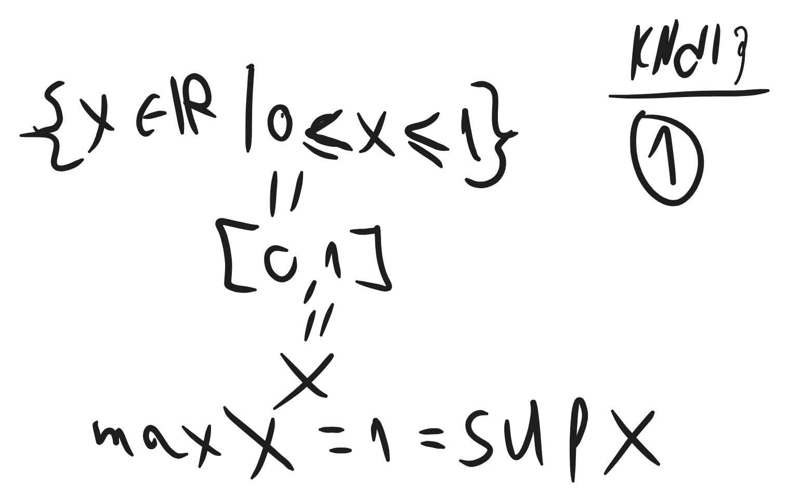
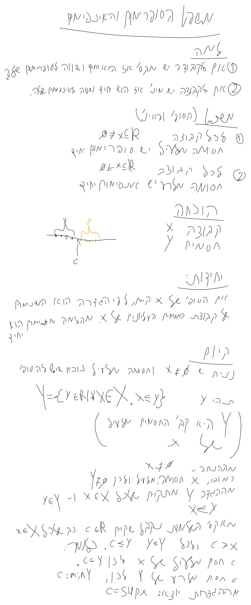
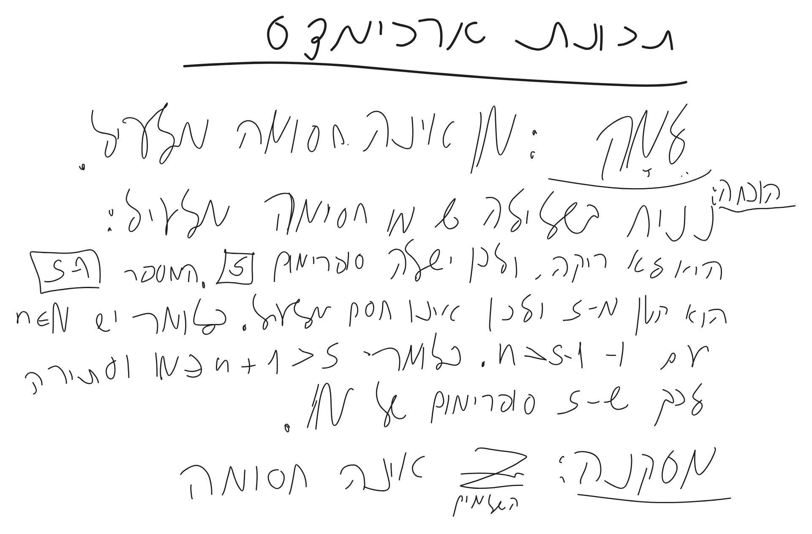
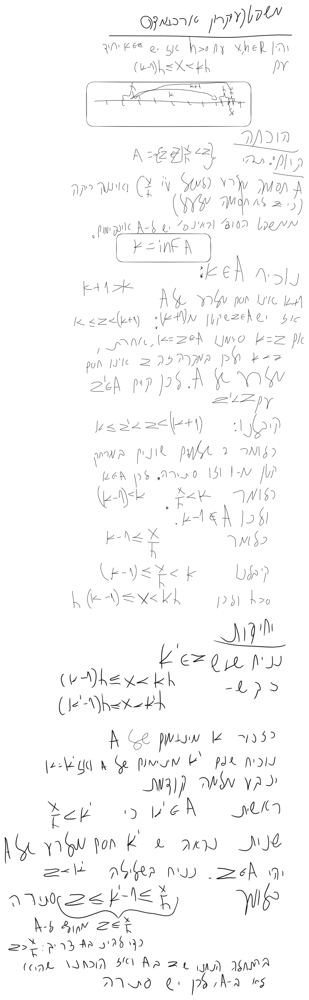

# חשבון אינפיניטסימלי 1 - הרצאה 2

> [!NOTE]
> **סיכום קצר**
>
> - **הנושא המרכזי:**
> - **הרעיון המרכזי / מה לקחת מההרצאה:**

---

## 1. מושגים והגדרות מרכזיים

> [!IMPORTANT]
> **הגדרות ותכונות נשמרות**
>
> 

---

## 2. סיכום ההרצאה

### נושא 1

> [!NOTE]
> **הערות והסברים**
>
>


# חסמים
מה הוא המספר הכי גדול מקטן מ1


```math
\{x\in \mathbb{R} |x<1\}
```


### חסומה מלעיל
קבוצה נקראת חסומה מלעיל אם יש מספר שגדול מ- או שווה לכל מספר אחר שיש בקבוצה הזאת. המספר הספציפי הזה נקרא חסם מלעיל.
### חסומה מלרע
קבוצה נקראת חסומה למרע אם יש מספר שקטן מ- או שווה לכל מספר אחר שיש בקבוצה הזאת. המספר הספציפי הזה נקרא חסם מלרע.

קבוצה שחסומה מלרע ומלעיל נקראת חסומה.


# מקסימום ומינימום
אם קיים בקבוצה מסוימת איבר ששווה או גדול משאר האיברים, האיבר נקרא המקסימום של הקבוצה ומסמנים: $`{}max X{}`$ 

אם קיים בקבוצה מסוימת איבר ששווה או קטן משאר האיברים, האיבר נקרא המינימום של הקבוצה ומסמנים: $`{}min X{}`$ 

# סופרמום ואינפימום
סופרמום - החסם מלעיל הקטן ביותר

אינפימום - החסם מלרע הגדול ביותר




# משפט הסופרימום והאינפימום



# תכונת ארכימדס


משהו ארוך מה ניסינו להוכיח?



