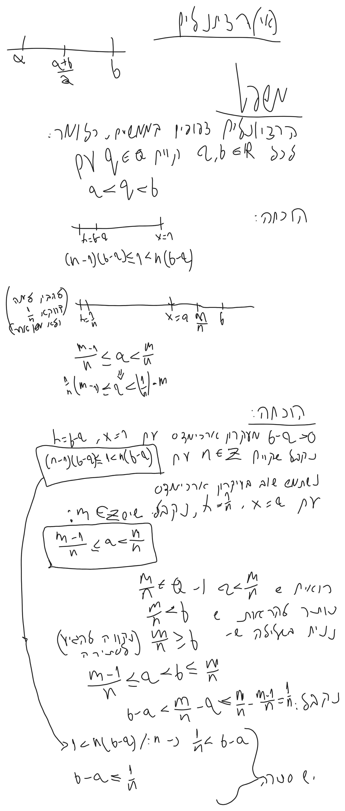
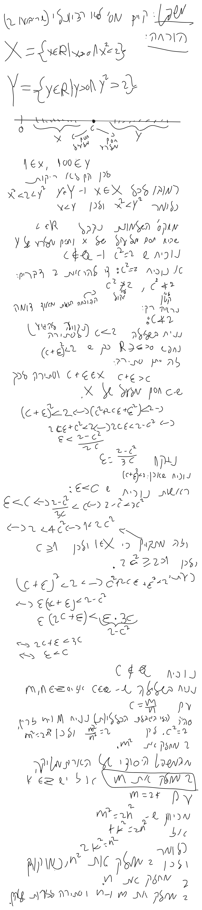

# חשבון אינפיניטסימלי 1 - הרצאה 3

> [!NOTE]
> **סיכום קצר**
>
> - **הנושא המרכזי:**
> - **הרעיון המרכזי / מה לקחת מההרצאה:**

---

## 1. מושגים והגדרות מרכזיים

> [!IMPORTANT]
> **הגדרות ותכונות נשמרות**
>
> 

---

## 2. סיכום ההרצאה

### נושא 1

> [!NOTE]
> **הערות והסברים**
>
>

