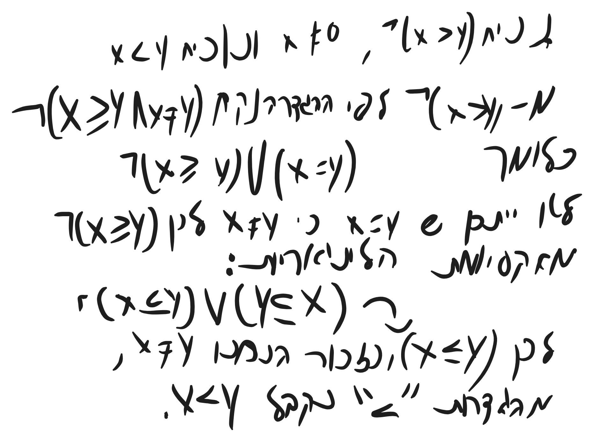
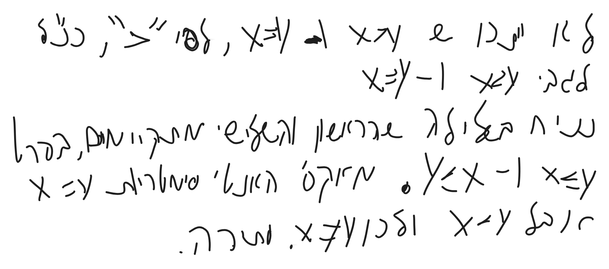
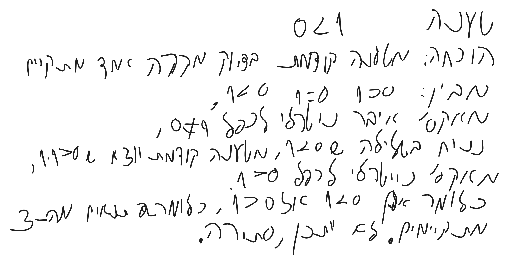

# חשבון אינפיניטסימלי 1 - הרצאה 1

> [!info] סיכום קצר
> - **הנושא המרכזי:**
> - **הרעיון המרכזי / מה לקחת מההרצאה:**

---

## 1. מושגים והגדרות מרכזיים

> [!abstract] הגדרות ותכונות נשמרות
> 

---

## 2. סיכום ההרצאה

### נושא 1

> [!note] הערות והסברים
>

yoni.zohar@biu.ca.il

zorich - mathematical analysis

טענה: לכל  x,y ממשיים מתקיים בדיוק אחד מהמקרים הבאים:
x>y, x=y, x< y
הוכחה:
ראשית נוכיח שלפחות אחד התנאים מתקיים.

שנית נוכיח שלא ייתכן ששני תנאים מתקיימים.

הוכחה ללמה 1>0:

$$
\neg(x>y) \\ \neg(x=y)\\
\neg(x\geq y\land x\neq y )\\
x\neq y\\
\neg(x\geq y)\vee x=y \implies\\
\implies\neg(x\geq y)\\
x\leq y \vee \underbrace{ y\leq x }_{ \text{לא מתקיים} }\\
x > y
$$

$$
\neg(x>y)\text{נניח}x\neq y\\
x<y \text{נוכיח }\\
\neg(x>y) 
$$

