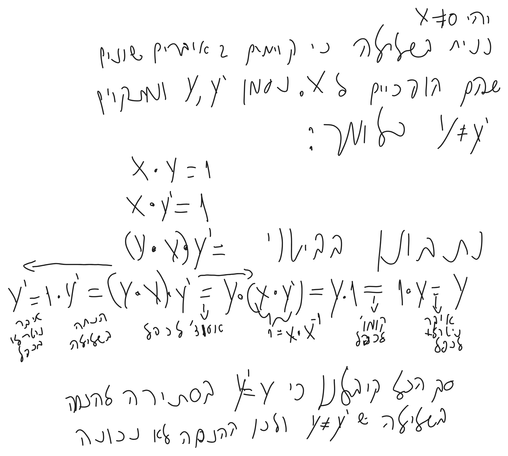
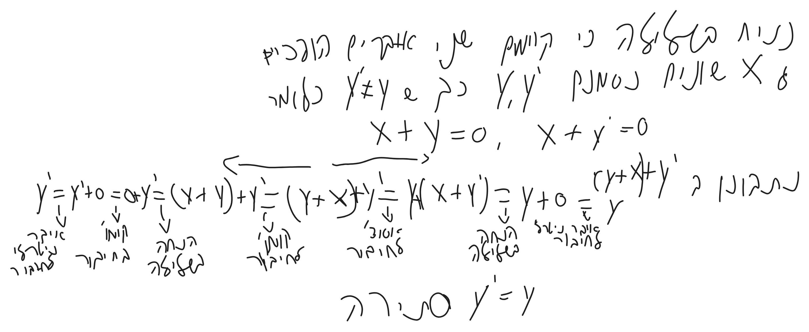
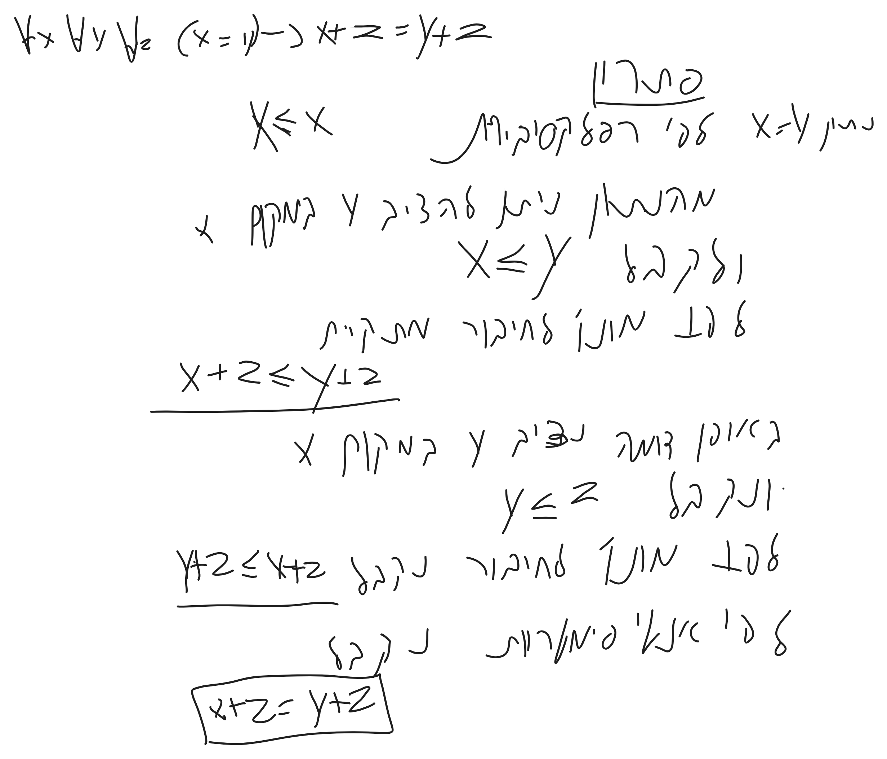

# חשבון אינפיניטסימלי 1 - תרגול 2


# קבוצות מספרים


```math
\begin{gathered}
\overbrace{ \mathbb{N} }^{ \text{טבעיים} }\subseteq \overbrace{ \mathbb{Z} }^{ \text{שלמים} }\subseteq \underbrace{ \overbrace{ \mathbb{Q} }^{ \text{רציונלים} }   }_{ \left\{ \frac{p}{q}|p,q\in \mathbb{Z} \right\} }\subseteq \overbrace{ \mathbb{R} }^{ \text{ממשיים} } \\
\end{gathered}
```


- המספרים הממשיים הם שדה כלומר יש להם סגירות עם + , - , * , \ 
- סימן $`{}\leq{}`$ שנקרא יחס סדר מלא.
- הערה: נסמן בקיצור $`{}x>y{}`$ במקום $`{}x\leq y\land x\neq y{}`$


# האקסיומות של הממשיים
אקסיומות לחיבור: 
1) איבר ניטרלי לחיבור $`{}\forall y. y+0=y{}`$
2) איבר הופכי לחיבור: $`{}\forall x\exists y.x+y=0{}`$  נסמן את y ב x-
3) אסוציאטיביות לחיבור: $`{}\forall x\forall y\forall z.(x+y)+z=x+(y+z){}`$ 
4) קומוטטיביות לחיבור: $`{}\forall x\forall y.x+y=y+x{}`$

אקסיומות לכפל:
5) איבר ניטרלי לכפל $`{}1\neq 0 \forall y. y\cdot 1=y{}`$ 
6) איבר הופכי לכפל: $`{}\forall x(x\neq 0)\exists y.x\cdot y=1{}`$  נסמן את y ב x-
7) אסוציאטיביות לכפל: $`{}\forall x\forall y\forall z.(x\cdot y)\cdot z=x\cdot(y\cdot z){}`$ 
8) קומוטטיביות לכפל: $`{}\forall x\forall y.x\cdot y=y\cdot x{}`$

אקסיומה לכפל וחיבור: $`{}{}`$
9) דיסטטיביות: $`{}\forall x\forall y\forall z. x\cdot(y+z)=x\cdot y+x\cdot z{}`$

אקסיומה על יחס סדר:
10) רפלקטיביות: $`{}\forall x. x\leq x{}`$
11) אנטיסימטריות: $`{}\forall x\forall y.(x\leq y)\land(y\leq x)\to x=y{}`$
12) טרנזיטיביות:$`{}\forall x\forall y\forall z.x\leq y\land y\leq z\to x\leq z{}`$
13) ליניאריות: $`{}\forall x\forall y.(x\leq y)\vee(y\leq x){}`$

אקסיומות על היחס והפעולות:
14) מונוטוניות לחיבור: $`{}\forall x\forall y\forall z. (x\leq y)\to x+z=y+z{}`$
15) מונוטוניות לכפל: $`{}\forall x\forall y(x\geq 0)\land(y\geq 0)\to x\cdot y\geq 0{}`$

אקסיומת השלמות
16) שלמות:$`{}\forall x\forall y\forall z.(x\neq 0\land y\neq 0\land\forall x\in X){}`$

# טענה 0
קיום הופכי יחיד לכפל.
### פתרון


# קיום איבר הופכי לחיבור



# שימור שוויון תחת חיבור


