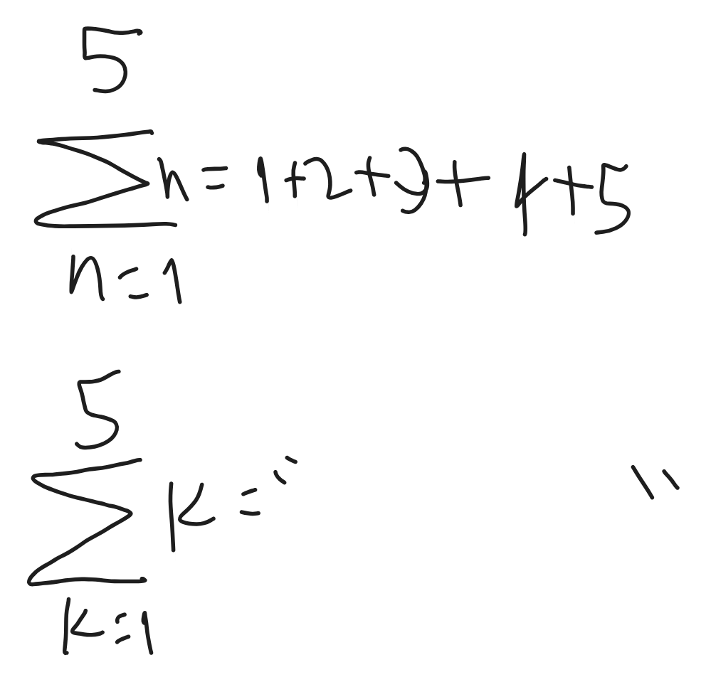
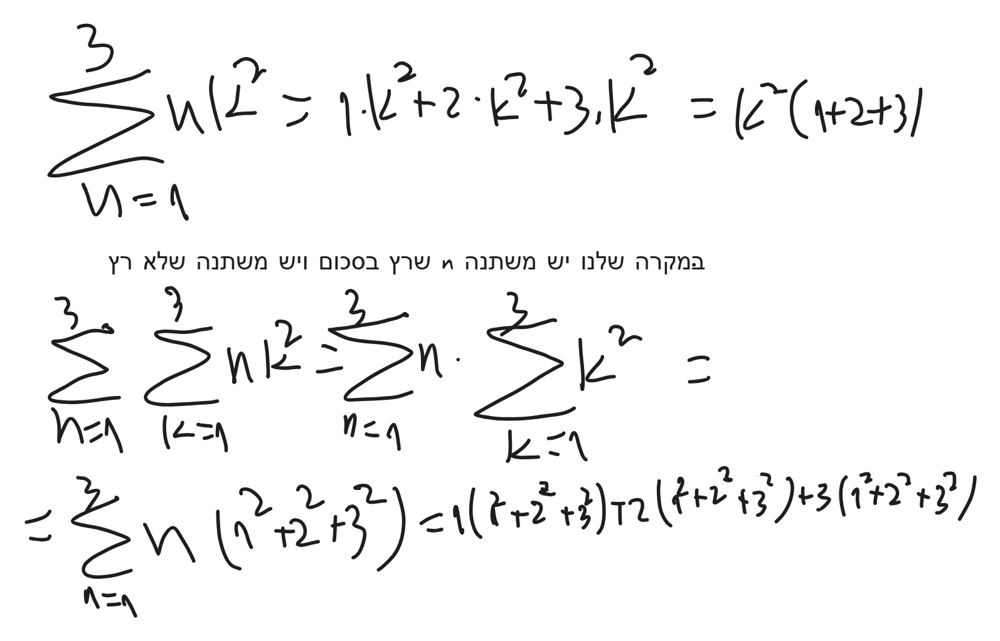
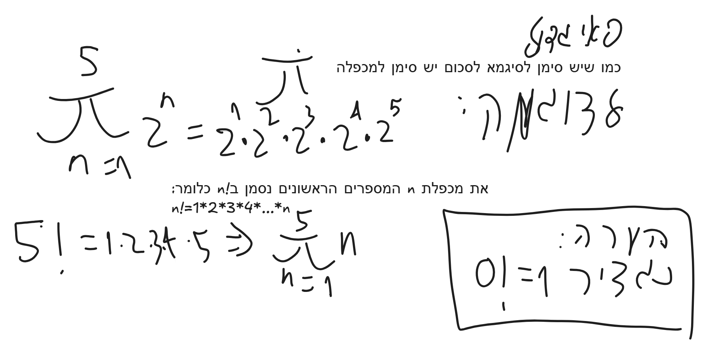
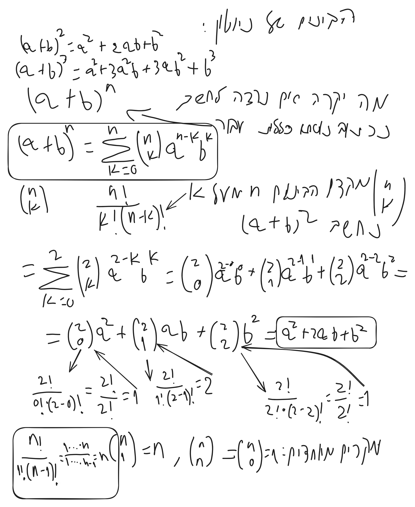
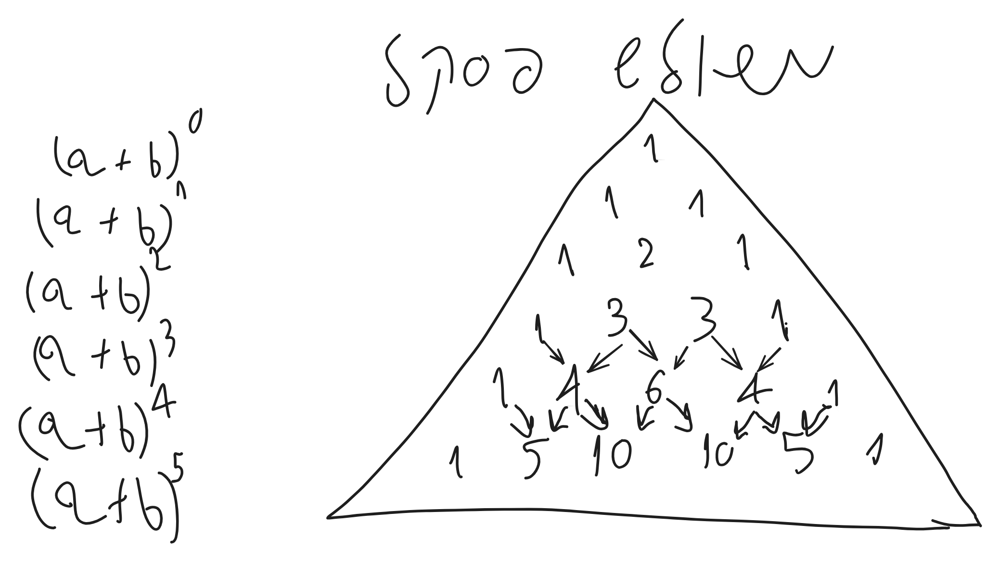
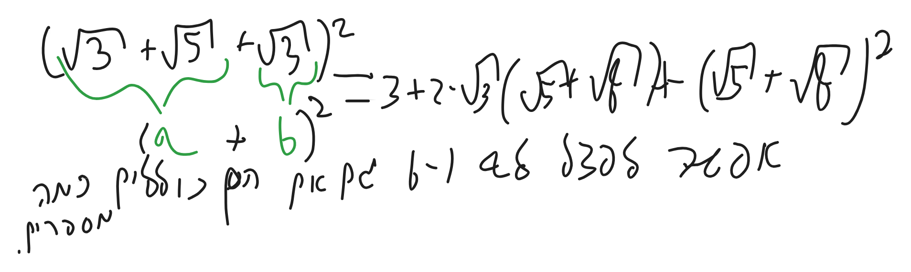
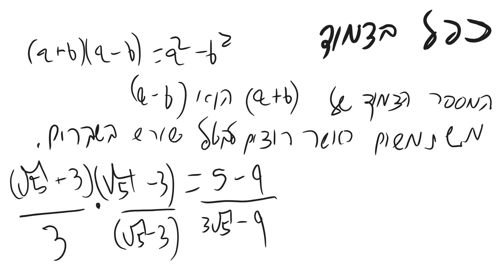
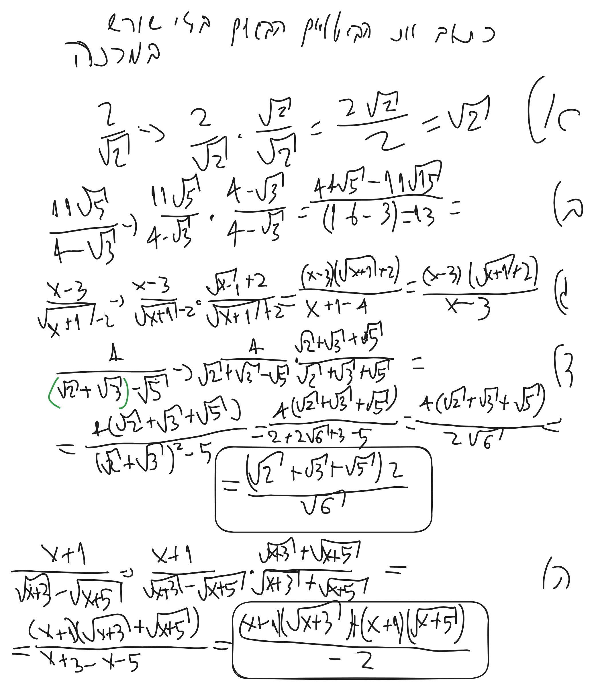
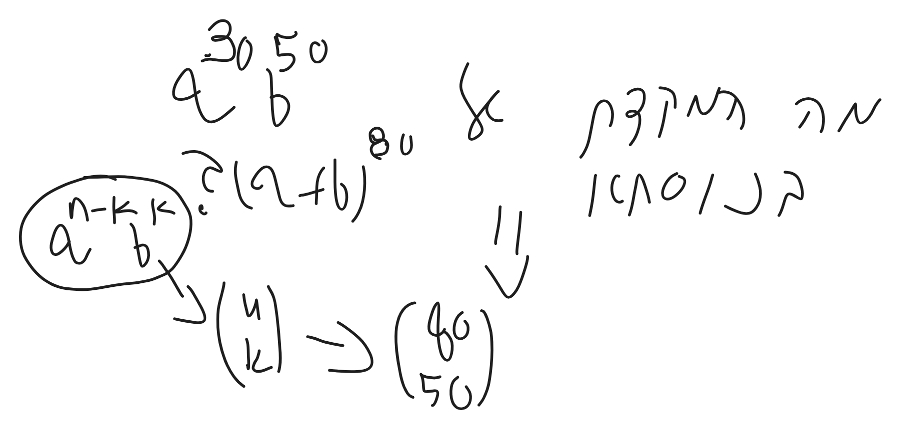

# אינפי1 תרגול 1

> [!info] סיכום קצר
> - **הנושא המרכזי:**
> - **הרעיון המרכזי / מה לקחת מההרצאה:**

---

## 1. מושגים והגדרות מרכזיים

> [!abstract] הגדרות ותכונות נשמרות
> 

---

## 2. סיכום ההרצאה

### נושא 1

> [!note] הערות והסברים
>

zvbe10@gmail.com

$$
\Sigma
$$

הפרמטר לא משנה, יכול להיות כל פרמטר.

פאי גדול:

מקדם הבינום של ניוטון:

משולש פסקל:

דוגמא לפיצול:

בפל בצמוד:

כפל בצמוד:

שימוש למקדם הבינום של ניוטון:

 

