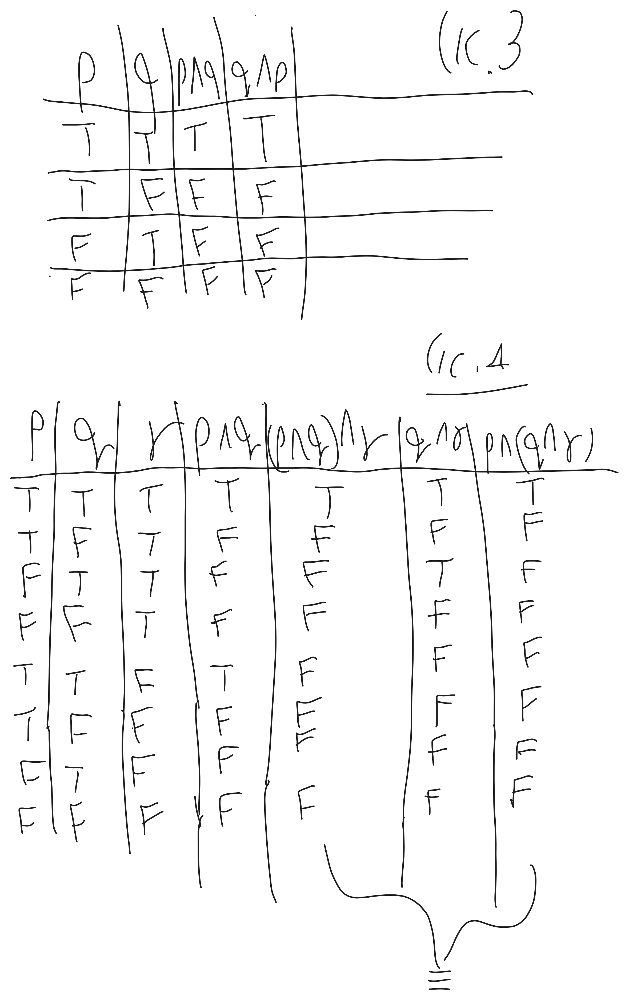
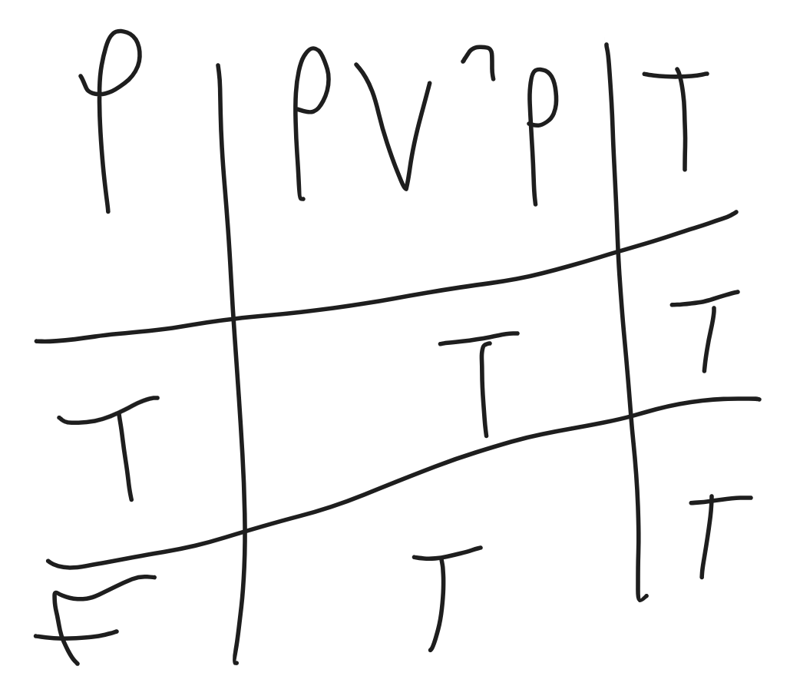

# מתמטיקה בדידה - הרצאה 1

> [!NOTE]
> **סיכום קצר**
>
> - **הנושא המרכזי:**
> - **הרעיון המרכזי / מה לקחת מההרצאה:**

---

## 1. מושגים והגדרות מרכזיים

> [!IMPORTANT]
> **הגדרות ותכונות נשמרות**
>
> 

---

## 2. סיכום ההרצאה

### נושא 1

> [!NOTE]
> **הערות והסברים**
>
>


# מבוא ללוגיקה
פסוק לוגי הוא טענה שניתן לחוות עליה TRUE\FALSE.
אטום הוא פסוק לוגי שלא ניתן "לפרק" לפסוקים קטנים יותר המחוברים על ידי קשרים.
לדוגמא:
"הכדור עגול **וגם** והירח סגול" 

**קשרים לוגיים נפוצים:**
p -> q 
החץ אומר גורר
גם זה עם $`\wedge`$ ו או זה $`\wedge`$ הפוך כלומר $`\vee`$


```math
\begin{array}{|c|c|c|c|c|c|c|}
\hline
P & Q & P \land Q & P \lor Q & P \rightarrow Q & P \leftrightarrow Q & P \oplus Q \\ \hline
T & T & T & T & T & T & F \\ \hline
T & F & F & T & F & F & T \\ \hline
F & T & F & T & T & F & T \\ \hline
F & F & F & F & T & T & F \\ \hline
\end{array}
```


**קשר אונארי:**
$`\neg`$ = not


```math
\begin{gathered}
\text{P | }\neg\text{P}\\
 \text{T | F}\\
   \text{F | T}
\end{gathered}
```


**הצרינו את הפסוקים הבאים:**
"הכדור עגול וגם הירח סגול"
פתרון: "P$`\wedge`$Q" כאשר הכדור עגול הוא P והירח סגול הוא Q.

"השמש צהובה והירח לא מרובע וצהוב"
השמש צהובה = p
הירח מרובע = q
הירח צהוב = r
p$`\wedge`$ $`\neg`$(q $`\wedge`$ r) פתרון

"כשאני במצב רוח טוב אני עושה כושר או לומדת מתמטיקה.
אם אני לומדת מתמטיקה ולא מבינה אז אין לי מצב רוח טוב ואני הולכת לעשות כושר"
מצב רוח טוב P
עושה כושר q
לומדת מתמטיקה r
מבינה s
פתרון
\[p -> (q $`\vee`$ r) ] $`\wedge`$ \[ (r $`\wedge`$ $`\neg`$s) -> ($`\neg`$p $`\vee`$ q) ]
$`{} \text{אומר שקול כלומר אותה משמעות} \equiv{}`$
p $`\wedge`$ q $`{}\equiv{}`$ q $`\wedge`$ p

פסוקים לוגים הם שקולים כאשר בכל השמה מתקבל בשניהם אותו הערך.


**שקילות לוגיות נפוצות:**
1.
$`\neg\neg`$p = p

2.
קומות הטיביות\חילופיות:
p$`\wedge`$ q $`{} \equiv{}`$ q $`\wedge`$ p
p $`\vee`$ q $`{} \equiv{}`$ q $`\vee`$ p
p $`{}\leftrightarrow q \equiv q \leftrightarrow p{}`$
p $`\oplus`$ q $`{}\equiv{}`$ q $`\oplus`$ p

$`{}\leftrightarrow{}`$ אם ורק אם (אמ"מ)

3.
p $`\wedge`$ F $`{}\equiv{}`$ F
p $`\wedge`$ T $`{}\equiv{}`$ p
p $`\vee`$ T $`{}\equiv{}`$ T
p $`\vee`$ F $`{}\equiv{}`$ p

4.
אסוציאטיביות\ קיבוציות (סדר הסוגריים לא משנה):
(p $`\wedge`$ q) $`\wedge`$ r $`{} \equiv {}`$ p $`\wedge`$ (q$`\wedge`$r)
(p $`{}\leftrightarrow{}`$ q) $`{}\leftrightarrow{}`$ r $`{} \equiv {}`$ p $`{}\leftrightarrow{}`$ (q$`{}\leftrightarrow{}`$r)
(p $`\oplus`$ q) $`\oplus`$ r $`{} \equiv {}`$ p $`\oplus`$ (q $`\oplus`$ r)
(p $`\vee`$ q) $`\vee`$ r $`{} \equiv {}`$ p $`\vee`$ (q $`\vee`$ r)


הוכחה ל3.א ו4.א:

.
5.
דיסטריביוטיביות \ פילוג:
p $`\wedge`$ (q $`\vee`$ r) $`{}\equiv{}`$ (p $`\wedge`$ q) $`\vee`$ (p $`\wedge`$ r)
p $`\vee`$ (q $`\wedge`$ r) $`{}\equiv{}`$ (p $`\vee`$ q) $`\wedge`$ (p $`\vee`$ r)

היום בערב אני שותה קפה וגם עושה פילאטיס ויוגה

6.
דה מורגן:
$`\neg`$(p $`\wedge`$ q) $`{}\equiv{}`$ $`\neg`$p $`\vee`$ $`\neg`$q
$`\neg`$(p $`\vee`$ q) $`{}\equiv{}`$ $`\neg`$p $`\wedge`$ $`\neg`$q

7.
$`{}p \to q \equiv \space \neg q \to \neg p{}`$
אם הכנתי פאי תפוחים הכנתי קינוח
אם לא הכנתי קינוח אז לא הכנתי פאי תפוחים
8.
$`{}p \to q \equiv \space \neg p \space  \vee \space q{}`$

9.
$`{}p \space \oplus q \equiv \neg (p \leftrightarrow q){}`$

10.
p $`\wedge`$ p $`{}\equiv{}`$ p
p $`\vee`$ p $`{}\equiv{}`$ p

11.
p $`\vee`$ $`\neg`$p $`{}\equiv{}`$ T
p $`\wedge`$ $`\neg`$p $`{}\equiv{}`$ F
טאוטולוגיה זה פסוק לוגי שבכל השמה נקבל ערך T


12.
$`{}p \leftrightarrow q \equiv (p\to q){}`$ $`\wedge`$ $`{} (q \to p){}`$

13.
$`{} p \implies p\space \vee \space q{}`$

14.
p $`\wedge`$ q $`{}\implies{}`$ p


$`{}\implies{}`$הגרירה הזאת תמיד יוצאת T 

תרגיל
הוכיחו ש
($`\neg`$p $`\wedge`$ q) $`\vee`$ $`\neg`$(p $`\vee`$ q) $`{} \equiv{}`$ $`\neg`$p

$`\neg`$(p $`\vee`$ q) $`{}\equiv{}`$ $`\neg`$p $`\wedge`$ $`\neg`$q

($`\neg`$p $`\wedge`$ q) $`\vee`$ ($`\neg`$p $`\wedge`$ $`\neg`$q) $`{}\equiv{}`$ $`\neg`$p$`\wedge`$(q $`\vee`$ $`\neg`$q) $`{}\equiv{}`$ $`\neg`$p
(q $`\vee`$ $`\neg`$q) $`{}\equiv t{}`$            ,      r $`\wedge`$ T $`{}\equiv T{}`$ 


