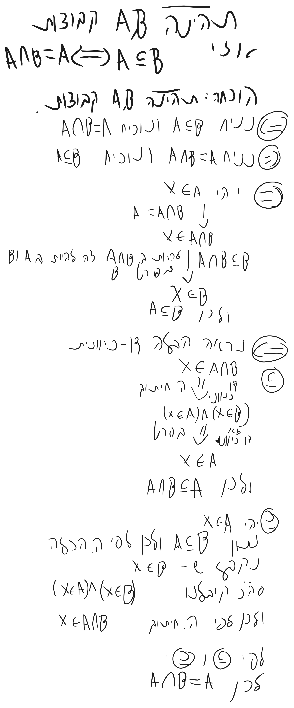

# מתמטיקה בדידה - הרצאה 3

> [!NOTE]
> **סיכום קצר**
>
> - **הנושא המרכזי:**
> - **הרעיון המרכזי / מה לקחת מההרצאה:**

---

## 1. מושגים והגדרות מרכזיים

> [!IMPORTANT]
> **הגדרות ותכונות נשמרות**
>
> 

---

## 2. סיכום ההרצאה

### נושא 1

> [!NOTE]
> **הערות והסברים**
>
>


תהינה A,B קבוצות
אזי $`{}A\cap B = B\cap A{}`$

הוכחה: תהינה A,B קבוצות.
נוכיח הכלה דו כיוונית.


```math
\begin{gathered}
x \ \ \text{יהי}\\
x \in A\cap B \leftrightarrow \\ \\
\leftrightarrow(x\in A) \land (x\in B)\leftrightarrow \\
\leftrightarrow(x\in B)\land(x\in A)\leftrightarrow  \\
\leftrightarrow x\in B\cap A\\
A\cap B=B\cap A\ \ \text{ולכן}
\end{gathered}
```


כללים בסיסיים:
תהינה:$`{}A,B,c\subseteq u{}`$ קבוצות. אזי
1)


```math
\begin{gathered}
1) \\
A\cap A=A\\
A\cup A=A\\2) \\
A\cup\emptyset=A\\
A\cap\emptyset=\emptyset \\
3) \\ \text{'קומו}\\
   A\cap B=B\cap A\\
   A\cup B=B\cup A
   \\A\Delta B=B\Delta A\\4)\\ \text{'אסוצ}\\
   A\cap (B\cap C)=(A\cap B)\cap C\\5)\\ \text{:פילוג}\\
   A\cap(B\cup C)=(A\cap B)\cup(A\cap C)\\
   A\cup(B\cap C)=(A\cup B)\cap(A\cup C)\\6)\\ \text{דה מורגן}
   \\ (\bar{A\cup B}= \bar A\cap\bar B)\\
   (\bar{A\cap B}= \bar A\cup\bar B) \\ 7) \text{.}\\
   (A\subseteq B)\land(B\subseteq C)\implies A\subseteq C \\ 8\text{)} \\
   A\cap B\subseteq A \subseteq A\cup B \\ 9)\\
   A\cup B\subseteq C <-  A,B\subseteq C \\ 10)
   \\ \bar{u^c}=\emptyset,\emptyset^c= u\\11)\\(A^c)^c=A\\12)\\ A\cup A^c=\bar u,A\cap A^c=\emptyset\\13)\\
   A\setminus B =A\cap B^c \\ 14) \\
   A\Delta B=(A\cup B)\setminus(B\cap A)
\end{gathered}
```


הוכחה ל5א:
תהינה $`{}A,B,c\subseteq\bar u{}`$ קבוצות.
נוכיח כלה דו כיוונית.


```math
\begin{gathered}
x\in A\cap(B\cup c)\\\text{ה. חיתוך} \leftrightarrow \\
(x\in A)\land(x\in B\cup C)\\ \text{ה. איחוד} \leftrightarrow
\\ (x\in A)\land[(x\in B)\vee(x\in C)]\\ \text{}
\\ [(x\in A)\land(x\in B)]\vee[(x\in A\land(x\in C))] \\
\\ (x\in A\cup B)\vee(x\in A\cup C)\\
\\ x\in(A\cup B)\cap(A\cup C)
\end{gathered}
```


8)
$`{}A\cup B\subseteq A \subseteq A\cup B{}`$ 
נוכיח ש $`{}A\cap B\subseteq A{}`$וגם $`{}A\subseteq A\cup B{}`$:
א)
יהי $`{}x\in A\cap B{}`$
ה.חיתוך
$`{}x\in A \ \ \text{וגם}\ \ x\in B{}`$

בפרט: $`{}x\in A{}`$
ולכן $`{}A\cap B\subseteq A{}`$
ב)
יהי $`{}x\in A{}`$
-> $`{}(x\in A)\vee(x\in B){}`$
ה.איחוד:
$`{}x\in A\cup B{}`$

9)
הוכחה:
תהינה A,B,C קבוצות
נניח $`{}A,B\subseteq C \\(\text{ונוכיח} A\cup B\subseteq C){}`$
 יהי $`{}x\in A\cup B{}`$
 ה. איחוד
 $`{}(x\in A)\vee(x\in B){}`$
 $`{}A\subseteq C \ \ \text{וגם}\ \ B\subseteq C \\\downarrow\\ (x\in C)\vee(x\in C)\\ \downarrow (p\vee p \equiv p) \\ x\in C \text{לכן}\\ A\cup B\subseteq C{}`$


טענה:



# קבוצת החזקה:
הגדרה: תהי A קבוצה. נגדיר
קבוצת החזקה של A:
$`{}P(A):={}`${$`{}B|B\subseteq A{}`$}
דוג':
A={1,2}
$`{}P(A)={}`${ $`{}\emptyset{}`$, {1}, {2}, {1,2} }

מסקנה: תה' A קבוצה. זי
$`{}\emptyset \in P(A){}`$
הוכחה: תהי A קבוצה
לפי שיעור קודם $`{}\emptyset \subseteq A{}`$
$`{}\downarrow \text{ה. קבוצת חזקה}{}`$
$`{}\emptyset \in P(A){}`$

טענה: תהינה A,B קבןצות. אזי
$`{}P(A) \subseteq P(B) \leftrightarrow A\subseteq B{}`$
