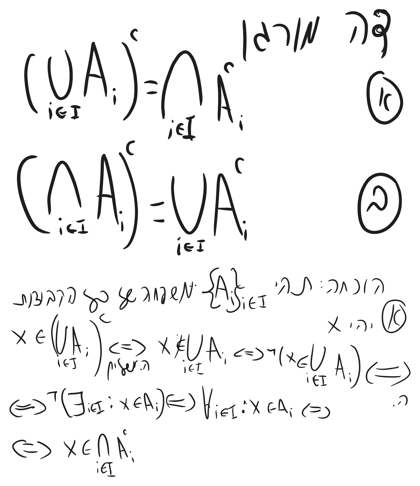

# מתמטיקה בדידה - הרצאה 4

> [!NOTE]
> **סיכום קצר**
>
> - **הנושא המרכזי:**
> - **הרעיון המרכזי / מה לקחת מההרצאה:**

---

## 1. מושגים והגדרות מרכזיים

> [!IMPORTANT]
> **הגדרות ותכונות נשמרות**
>
> 

---

## 2. סיכום ההרצאה

### נושא 1

> [!NOTE]
> **הערות והסברים**
>
>


```math
\overbrace{ P(A)= \{B|B\subseteq A\} }^{ B\in P(A)\leftrightarrow B\subseteq A }
```


עבור A סופי מספר האיברים ב P(A) הוא $`{}2^{|A|}{}`$ 
תהינה A,B קבוצות


```math
A\subseteq B \leftrightarrow P(A)\subseteq P(B)
```


הוכחה:
תהינה A,B קבוצות.
 -> נניח A$`{}\subseteq{}`$B ונוכיח $`{}P(A)\subseteq P(B){}`$
 

```math
\begin{gathered}
D\in P(A) \ \ \ \text{יהי } \\
 \ \ \ \ \ \ \ \ \ \ \ \downarrow\text{קבוצת חזקה}\\
 D\subseteq A\\
 \ \ \ \ \ \ \ \ \downarrow A\subseteq B\\
 D\subseteq B\\
 \downarrow\\
 D\in P(B)
\end{gathered}
```


 
 <- נניח $`{}P(A)\subseteq P(B){}`$  נוכיח  $`{}A\subseteq B{}`$
 

```math
\begin{gathered}
יהי x\in A\\
 \downarrow \\
 \{x\}\subseteq A\\
 \ \ \ \ \ \ \  \ \downarrow \text{קבוצת חזקה}\\
 \{x\} \in P(B)\\
 \downarrow \\
 \{x\}\subseteq B\\
 \downarrow \\
 x\in B\\  \downarrow \text{קבוצת חזקה} \\
 \{x\}\subseteq B \\ \downarrow \\ A\subseteq B
\end{gathered}
```


תהינה A,B קבוצות
הוכיחו\הפריכו:
1) $`{}P(A/B)= P(A)/P(B){}`$
2) $`{}P(A\cap B)=P(A)\cap P(B){}`$
3) $`{}P(A\cup B)=P(A)\cup P(B){}`$

# חיתוכים ואיחודים כלליים
הגדרה: תהי I קבוצות אינדקסים ותהי $`{}\{A i\}_{i\in I}{}`$ משפחה של קבוצות
נגדיר:


```math
\begin{gathered}
\bigcup_{i\in I}A_{i}:=\{x|\exists i\in I: x\in A_{i}\}\\
\bigcap_{i\in I}A_{i}:=\{x|\forall i\in I: x\in A_{i}\}
\end{gathered}
```


$`{}\text{כל המספרים בין 1 ו2 כולל } [1,2]{}`$
דוג':


```math
\begin{gathered}
n\in N \ \ \text{נגדיר לכל }\\
A_{n}=\left[ 1,n) \\
\bigcap_{n\in N}A_{n},\bigcup_{n\in N}A_{n}\ \ \ \text{חשבו והוכיחו  }\\ \\
A_{1}=[1,1 \right)\\ A_{2}=[1,2)\\ A_{3}=[1,3) \\\text{פתרון}\\
\bigcap_{n\in N}A_{n}=\emptyset\ \ \text{נוכיח } \\
x\in\bigcap_{n\in N}A_{n}\\ \downarrow \text{ה. חיתוך כללי}\\
\forall n\in \mathbb{N}:x\in A_{n}\\ \downarrow \text{בפרט}\\
x\in A_{1}=\emptyset \text{סתירה!}\\
\text{ולכן: } \\
\bigcap_{n\in \mathbb{N}}A_{n}=\emptyset
\end{gathered}
```


```math
\begin{gathered}
\bigcup_{n\in \mathbb{N}}A_{n}=\{x\in \mathbb{R}|x\geq 1\}\\\text{נוכיח } \\ \\
\bigcup_{n\in \mathbb{N}}A_{n} \\ \\ \text{חץ דו כיווני} \downarrow \text{ה. איחוד כללי}\\ \\
\exists n\in \mathbb{N} : x\in A_{n} \\ \\ \text{חץ דו כיווני}\downarrow A_{n}\text{.ה}\\ \\
\exists n\in \mathbb{N}: [1,n)\\ \\ \text{חץ דו כיווני}\downarrow\text{בפרט}\\ \\
1\leq x\\ \ \ \ \ \ \ \ \ \ \  \ \ \ \ \ \ \ \ \ \ \downarrow n=\lceil{x}\rceil +1 \\
\end{gathered}
```


```math
\begin{gathered}
\text{ אינסופי } n\text{לכן בגלל ש } \\
 \bigcup_{n\in \mathbb{N}}A_{n}=[1,\infty)
\end{gathered}
```



# אינדוקציה
 עקרון האינדוקציה: תהי $`{}Q(n){}`$ טענה על המספרים הטבעיים
 נניח שהוכחנו :
 א) Q(1) נכונה
 ב) צעד האינדוקציה: $`{}Q(n)\to Q(n+1){}`$
 דוגמא:
 לכל n טבעי מתקיים:
 

```math
1 + \dots n = \frac{n(n+1)}{2}
```


 בסיס: n=1


```math
1=\frac{1(1+1)}{2}\checkmark
```


צעד: נניח שהאענה נכונה ל-n כלשהי ונוכיח אותה עבור n+1


```math
1 + \dots+n+(n+1)=\frac{n(n+1)}{2}+(n+1)=(n+1)\left( \frac{n+2}{2} \right)=\frac{(n+1)(n+2)}{2}
```


